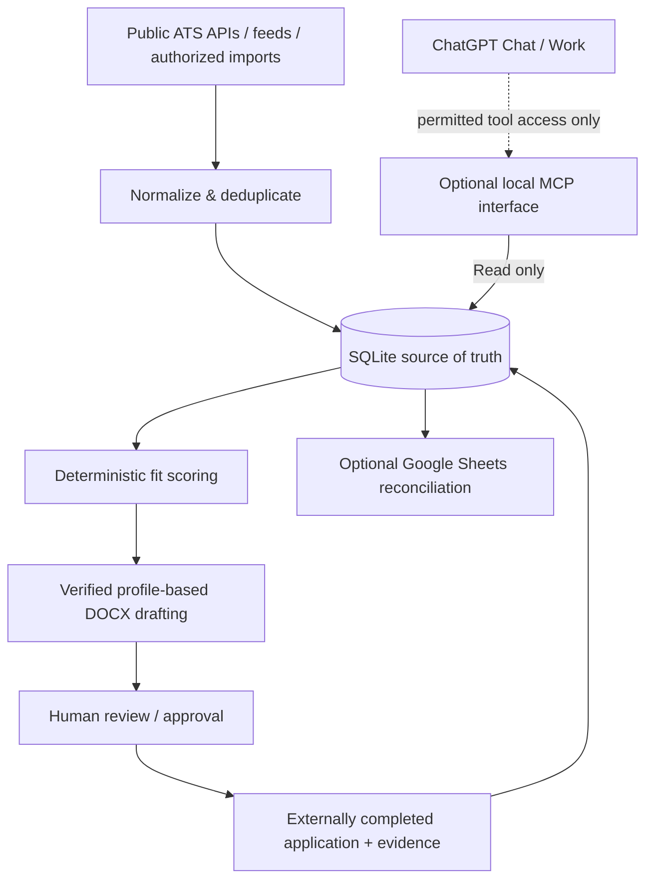

# Internship Agent

**An open-source, local-first, ChatGPT-oriented internship workflow platform.**

Internship Agent combines Python employer job-board readers, explainable ranking,
profile-based documents and a SQLite application ledger. The target workflow adds
continuous discovery, structured internship eligibility, verified application
materials, approved application assistance and recruiting outcome tracking.
Those additions have explicit [development gates](docs/ROADMAP.md).

The local CLI works independently of ChatGPT. ChatGPT Chat/Work is the preferred
intelligent interface where supported; authenticated MCP and Google integrations
are optional. A lightweight local dashboard is planned. Deterministic processing
handles routine work; optional AI assists language/judgment without inventing
facts or authorizing submissions and recruiter messages.

**Status: working local prototype, not production-ready.** Package metadata is
0.4.0; runtime version drift and the proposed release sequence are documented in
[the release plan](docs/RELEASE_PLAN.md). Most tests are offline/mocked.
Greenhouse, Lever and Ashby each have [one-board live qualification](docs/LIVE_ATS_VALIDATION.md), Sheets has
[operator-reported synthetic live results](docs/SHEETS_VALIDATION.md), and local
MCP stdio/HTTP is validated. Actual authenticated ChatGPT invocation is pending.
[PR #8's prepared gateway](docs/MCP_EXTERNAL_CONNECTIVITY.md) is included;
no public endpoint is active. There is **no automatic application
submission or recruiter emailing**. See the [capability matrix](docs/CAPABILITIES.md).

## Features

| Component | Current capability | Limitation |
|---|---|---|
| Discovery | 18 source types; Greenhouse/Lever/Ashby live-qualified; compatible employer registry | One public board per named provider, not all sources/boards; feeds can change or rate-limit |
| Fit scoring | Explainable weighted role, skill, location, freshness, compensation, employer scoring | Heuristic score, **not** an interview/hiring probability |
| Screening | Flags senior/graduate/clearance language | Does not determine legal/work eligibility |
| Documents | Single-column DOCX resume and cover-letter draft from a verified profile | No guarantee of passing ATS; requires human review |
| Tracking | SQLite status ledger with audit events and explicit approval step | Records confirmation evidence; doesn't independently verify submission |
| Google | Gmail lead staging; exact Sheets previews, confirmed sync and local audit | Basic synthetic Sheets sync live-tested by operator; Gmail and broader scenarios remain unqualified |
| MCP | Read-only stdio/HTTP tools and a narrow OAuth gateway with HTTPS resource identity | [Gateway qualification](docs/MCP_EXTERNAL_CONNECTIVITY.md); Funnel remains disabled and actual ChatGPT invocation is pending |

## Quickstart (Windows, Python 3.11+)

```powershell
# From the extracted repository root
.\scripts\setup-windows.ps1
.\.venv\Scripts\Activate.ps1

# Safely demonstrate the pipeline without network or personal data
python scripts/demo.py

# Copy then edit your PRIVATE, untracked configuration files
Copy-Item config\profile.example.json config\profile.json -ErrorAction SilentlyContinue
Copy-Item config\sources.example.json config\sources.json -ErrorAction SilentlyContinue

# Optional: discover from configured permitted sources (requires internet)
internship-agent discover
internship-agent rank --min-score 55
```

Employer registration remains explicit and performs no network/database access:
`internship-agent add-source <public-board-url> --company <name>`;
`internship-agent list-sources` inspects the local registry. Optional
`--careers-url`, `--employer-id` and `--disabled` support reviewed metadata and
verified board linking. See [registry configuration and compatibility](docs/EMPLOYER_REGISTRY.md).

The demo creates `demo-output/` containing a fictional three-job database, ranking summary and DOCX resume/letter. It does not authenticate, search real jobs, submit forms, or send email. **Never use the synthetic profile as your real resume.**

For macOS/Linux:

```bash
python3 -m venv .venv
source .venv/bin/activate
python -m pip install -e '.[test]'
python scripts/demo.py
python -m pytest -q
```

## ChatGPT and Work integration

ChatGPT Chat/Work is preferred when a supported connection exists; essential local
development does not wait for it. Install the optional MCP extra with
`python -m pip install -e '.[mcp]'`. SDK 2.3.0 calls are
[validated locally](docs/MCP_VALIDATION.md). The operator confirmed custom MCP
controls in Plus, but actual cloud invocation is **not proven**. Issue #3 remains
open. The approved [zero-additional-cost architecture](docs/MCP_CONNECTION_OPTIONS.md)
has a prepared loopback gateway; activation still requires local qualification and separate
authorization. See [integration options](docs/INTEGRATION.md).

ChatGPT can independently work with connected Google Sheets and Gmail for user-approved workflows without a direct MCP connection; that is **not** equivalent to executing the local backend. A standalone script cannot use a ChatGPT subscription as an unmetered model API.

## Why this project exists

A collection of job listings is easy to build. A trustworthy pipeline requires handling duplicates, sourcing, field confidence, eligibility warnings, verified resume claims, explicit approvals, and sync conflicts. This project makes those tradeoffs visible and testable.

## Architecture



**Boundaries:** No unauthorized account scraping; no anti-bot bypass; no automated submission; no recruiter email sending; job descriptions and emails are untrusted input. Google writes are previewed and separately confirmed. The application ledger retains status transitions and events.

## Reproducibility and development

```powershell
python -m pytest -q
python scripts/check_repo_hygiene.py
python -m compileall -q src
```

[Architecture](docs/ARCHITECTURE.md) · [Capability matrix](docs/CAPABILITIES.md) · [Threat model](docs/THREAT_MODEL.md) · [Source coverage](docs/SOURCE_MATRIX.md) · [Master roadmap](docs/ROADMAP.md) · [Release gates](docs/RELEASE_PLAN.md) · [Demo](docs/DEMO.md) · [Contributing](CONTRIBUTING.md) · [Security policy](SECURITY.md)

GitHub Actions runs tests across supported Python versions and checks for common accidental private-file commits. The file-checker is not a substitute for full secret scanning or security review.

The [isolated Sheets validation guide](docs/SHEETS_VALIDATION.md) records operator-reported successful basic live sync and the focused local checks. Google credentials use a [shared per-user store](docs/GOOGLE_SETUP.md#credential-storage-and-compatibility), independent of `--data`. Install `.[test,google,mcp]` for the full offline SDK regression suite; CI does so on every supported Python version.

## Roadmap

1. Multi-provider ATS validation and employer registry are implemented in Issue #9;
   incremental scans, health and conservative posting lifecycle remain Issue #10
   ([scope and handoff](docs/NEXT_ENGINEERING_PR.md)).
2. Verified profile/eligibility, explainable ranking and document QA.
3. Recoverable local preparation/tracking, then Windows scheduling and dashboard.
4. Optional ChatGPT qualification in parallel; approved browser assistance next.
5. Verified recruiter workflows and analytics; optional cloud assessment last.

Named R1–R7 gates have proposed versions 0.5.0–0.10.0 only after acceptance;
cloud assessment has no promised version. [The master roadmap](docs/ROADMAP.md)
links issues/dependencies. The [prepared gateway](docs/MCP_EXTERNAL_CONNECTIVITY.md)
and [its local qualification](docs/MCP_GATEWAY_VALIDATION.md) preserve the three
read-only tools; actual authenticated ChatGPT invocation remains pending.
No release is published. No additional paid service, API credits or infrastructure
is required or enabled.

## Privacy and license

Your resume, real profile, application database, imported messages, generated documents and OAuth tokens must remain in the ignored local directories. The public repository includes only synthetic example data. Never paste credentials or real application records into issues. Licensed under the [MIT License](LICENSE); employment websites and third-party source APIs have their own terms.

> **Important:** This project helps organize and prepare applications. It cannot guarantee an ATS pass, an interview, employment, or that a particular posting is currently open.
