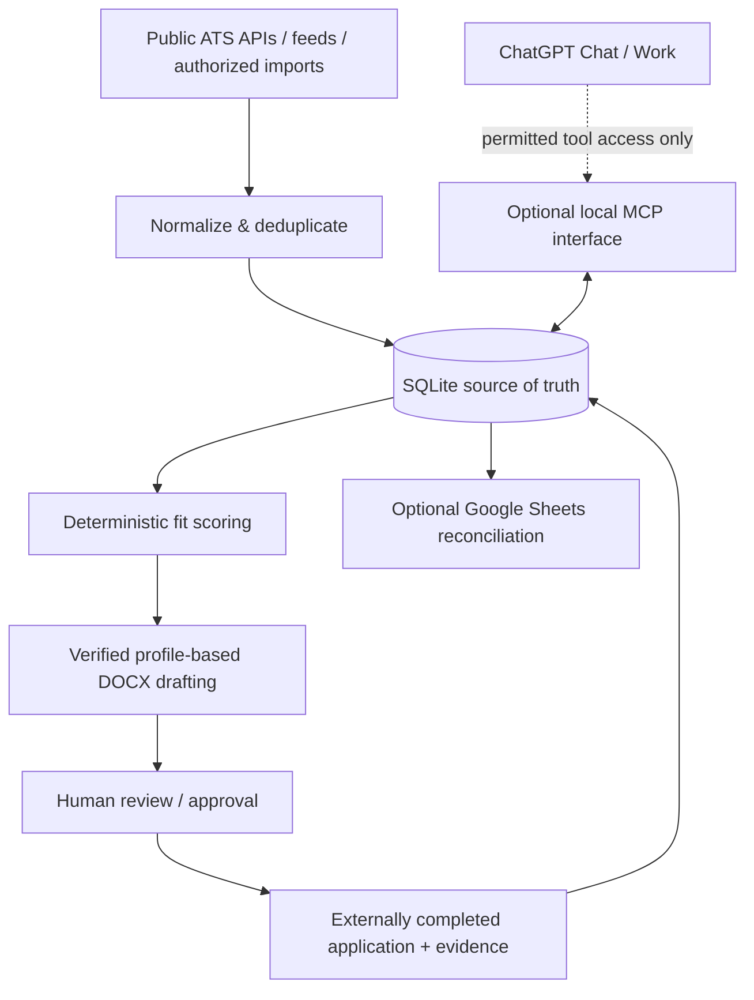

# Internship Agent

**Local-first internship discovery, job-fit ranking, and application preparation — designed for AI-assisted workflows.**

Internship Agent is an open-source Python project that combines employer job-board readers, an explainable matching engine, a SQLite application ledger, optional Google Workspace integrations, and an MCP tool interface. It's intended for students who want a disciplined, inspectable internship pipeline rather than a bulk-apply bot.

**Project status: v0.4.0 — working local prototype, not production-ready.** Most automated tests are offline/mocked. Greenhouse discovery has [live validation](docs/LIVE_ATS_VALIDATION.md), and basic synthetic Sheets synchronization has [operator-reported live results](docs/SHEETS_VALIDATION.md). Other provider endpoints, Gmail and MCP connections still need live validation. There is **no automatic job application submission or recruiter emailing**.

## Features

| Component | Current capability | Limitation |
|---|---|---|
| Discovery | 18 source types: public ATS feeds, public aggregators, RSS, approved JSON/CSV imports | No exhaustive global job index; feeds can change or rate-limit |
| Fit scoring | Explainable weighted role, skill, location, freshness, compensation, employer scoring | Heuristic score, **not** an interview/hiring probability |
| Screening | Flags senior/graduate/clearance language | Does not determine legal/work eligibility |
| Documents | Single-column DOCX resume and cover-letter draft from a verified profile | No guarantee of passing ATS; requires human review |
| Tracking | SQLite status ledger with audit events and explicit approval step | Records confirmation evidence; doesn't independently verify submission |
| Google | Gmail lead staging; exact Sheets previews, confirmed sync and local audit | Basic synthetic Sheets sync live-tested by operator; Gmail and broader scenarios remain unqualified |
| MCP | Read-only stdio/HTTP tools and a narrow OAuth gateway with HTTPS resource identity | [Gateway qualification](docs/MCP_EXTERNAL_CONNECTIVITY.md); Funnel remains disabled and actual ChatGPT invocation is pending |

## Quickstart (Windows, Python 3.11+)

```powershell
# From the extracted repository root
.\scripts\setup-windows.ps1
.\.venv\Scripts\Activate.ps1

# Safely demonstrate the pipeline without network or personal data
python scripts/demo.py

# Copy then edit your PRIVATE, untracked configuration files
Copy-Item config\profile.example.json config\profile.json -ErrorAction SilentlyContinue
Copy-Item config\sources.example.json config\sources.json -ErrorAction SilentlyContinue

# Optional: discover from configured permitted sources (requires internet)
internship-agent discover
internship-agent rank --min-score 55
```

The demo creates `demo-output/` containing a fictional three-job database, ranking summary and DOCX resume/letter. It does not authenticate, search real jobs, submit forms, or send email. **Never use the synthetic profile as your real resume.**

For macOS/Linux:

```bash
python3 -m venv .venv
source .venv/bin/activate
python -m pip install -e '.[test]'
python scripts/demo.py
python -m pytest -q
```

## ChatGPT and Work integration

The primary interface is intended to be ChatGPT Chat/Work; the backend offers a read-only stdio MCP adapter and a local CLI. Install the optional MCP extra with `python -m pip install -e '.[mcp]'`. SDK 2.3.0 initialization/discovery and tool calls are [validated locally](docs/MCP_VALIDATION.md). The operator has confirmed custom MCP controls in Plus, but cloud access is **not yet configured**. Review the [zero-additional-cost architecture proposal](docs/MCP_CONNECTION_OPTIONS.md); no external endpoint or tunnel is implemented before approval. See [integration options](docs/INTEGRATION.md).

ChatGPT can independently work with connected Google Sheets and Gmail for user-approved workflows without a direct MCP connection; that is **not** equivalent to executing the local backend. A standalone script cannot use a ChatGPT subscription as an unmetered model API.

## Why this project exists

A collection of job listings is easy to build. A trustworthy pipeline requires handling duplicates, sourcing, field confidence, eligibility warnings, verified resume claims, explicit approvals, and sync conflicts. This project makes those tradeoffs visible and testable.

## Architecture



**Boundaries:** No unauthorized account scraping; no anti-bot bypass; no automated submission; no recruiter email sending; job descriptions and emails are untrusted input. Google writes are previewed and separately confirmed. The application ledger retains status transitions and events.

## Reproducibility and development

```powershell
python -m pytest -q
python scripts/check_repo_hygiene.py
python -m compileall -q src
```

[Architecture](docs/ARCHITECTURE.md) · [Threat model](docs/THREAT_MODEL.md) · [Source coverage](docs/SOURCE_MATRIX.md) · [Roadmap](docs/ROADMAP.md) · [Demo walkthrough](docs/DEMO.md) · [Portfolio notes](docs/PORTFOLIO.md) · [Contributing](CONTRIBUTING.md) · [Security policy](SECURITY.md)

GitHub Actions runs tests across supported Python versions and checks for common accidental private-file commits. The file-checker is not a substitute for full secret scanning or security review.

The [isolated Sheets validation guide](docs/SHEETS_VALIDATION.md) records operator-reported successful basic live sync and the focused local checks. Google credentials use a [shared per-user store](docs/GOOGLE_SETUP.md#credential-storage-and-compatibility), independent of `--data`. Install `.[test,google,mcp]` for the full offline SDK regression suite; CI does so on every supported Python version.

## Roadmap

- **v0.4 (current):** public repo hygiene, synthetic offline demonstration, CI, documented tradeoffs and release artifacts.
- **v0.5:** Greenhouse public discovery validated; basic synthetic Sheets OAuth, confirmed append and repeat no-op operator-validated. New credential routing has a focused read-only local follow-up.
- **v0.6:** read-only MCP and a narrow HTTPS/OAuth gateway implemented; [Phase 3 qualification](docs/MCP_EXTERNAL_CONNECTIVITY.md) precedes any reviewed Funnel activation. An actual authenticated ChatGPT call is still required. Tailoring/format QA remains future work.
- **Future:** approved, platform-compliant application assistance; recruiter outreach drafts and confirmation monitoring.

## Privacy and license

Your resume, real profile, application database, imported messages, generated documents and OAuth tokens must remain in the ignored local directories. The public repository includes only synthetic example data. Never paste credentials or real application records into issues. Licensed under the [MIT License](LICENSE); employment websites and third-party source APIs have their own terms.

> **Important:** This project helps organize and prepare applications. It cannot guarantee an ATS pass, an interview, employment, or that a particular posting is currently open.
