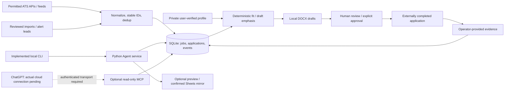

# System architecture

## Direction and implementation boundary

Internship Agent is a local-first Python workflow platform with a SQLite
application ledger. It is designed for ChatGPT-oriented assistance while remaining
usable without ChatGPT, MCP, Google or a model API. The CLI is implemented; the
lightweight local dashboard is planned. Deterministic processing handles routine
collection/filtering/scoring; optional AI helps with language and judgment.

The [capability matrix](CAPABILITIES.md) records the roadmap baseline and subsequent
[PR #8 gateway integration](https://github.com/aryanramz/internship-agent/pull/8).
Gateway/startup code is included in this revision; no external MCP
endpoint is active. See [roadmap](ROADMAP.md) and [release gates](RELEASE_PLAN.md).

## Current components

| Responsibility | Implemented boundary |
|---|---|
| Ingestion | `sources.py` retrieves/normalizes supported public APIs/feeds/imports; `models.py` validates board inputs and stable posting identity |
| Employer sources | `registry.py` extends local source JSON with employer identity/provenance/evidence; detection/suggestions reuse known URLs; CLI explicitly registers or lists without network |
| Ledger | `Store` in `store.py`: jobs, applications, events and staged email leads in SQLite |
| Discovery lifecycle | `SourcePage` / `DiscoveryState`: versioned SQLite source/run/provenance/evidence tables, atomic page ingestion/checkpoint, fenced restart and durable retry eligibility |
| Orchestration | `Agent` in `service.py`: discovery, ranked views, document preparation, tracking and separately authorized optional Google operations |
| Fit and documents | `scoring.py`: deterministic component scores/keyword warnings; `documents.py`: profile-based DOCX emphasis/drafts, not a claim-verification engine |
| Local interfaces | `cli.py` for the working pipeline; `tracker.py` for reviewed CSV export; `scripts/run-daily.ps1` is an existing routine runner, not a qualified scheduler |
| Optional Google | Per-user grants; Gmail read-only lead staging/review; Sheets preview/confirmed mirror synchronization |
| Optional MCP | Import-safe stdio, strict JWT/HTTP adapter and prepared `mcp_gateway*.py` route boundary; exactly three read-only tools, loopback only, no activation |

The external application box represents actions performed outside this backend.
The backend does not submit forms or send recruiter messages. It records evidence
supplied by the operator, without independently establishing employer receipt.

## Data ownership, identity and evidence

SQLite remains authoritative for job/application state. A Google Sheet is an
optional reviewed mirror, not a second authority. Local source JSON is the current
board configuration; Issue #9 extends it compatibly with an employer registry
without duplicating the application ledger or changing job IDs. Reads do not
migrate files; explicit registration is idempotent and atomic. Different boards
are linked only with an explicitly verified employer ID, not a shared name.
Profile/documents/credentials remain
private files; structured verified-fact provenance is planned in #11.

Posting IDs derive from provider, board token and posting ID. Issue #10 retains
distinct IDs even when canonical URLs match, with review-only candidate links
and separate provenance/availability evidence. No application history is moved.
Publication, first discovery and last-seen
timestamps have different meanings. Source failure/absence is not evidence of a
closed posting or a rejected application.

Job descriptions, alerts, URLs and messages are untrusted data. A saved lead is
not proof of a current opening. Current profile verification depends on user input;
existing document code does not establish every claim's truth. #11/#13 add explicit
provenance and QA. A fit score is neither eligibility nor a hiring probability.

## Application state and approval

The existing ledger starts `discovered → prepared → approved → submitted`, then
permits guarded assessment/interview/offer/rejected/withdrawn transitions.
`shortlisted` is also a declared status; do not infer a complete UI/state editor.
The exact transition rules live in `Store`, not in prompts.

Preparation can reset pre-submission approval. The ledger rejects preparation of
submitted/completed states, but `Agent.prepare` currently generates files before
that rejection, using deterministic filenames. A rejected preparation can therefore
overwrite existing documents; file protection is not established. #14 must guard
before generation and qualify file versioning/recovery. Recording submission requires approved state and nontrivial operator
evidence. `APPROVE <job_id>` is an explicit local confirmation mechanism, not
cryptographic human authentication. #14 must qualify document-version binding,
failure recovery and repeat actions before any browser assistant depends on it.
#17 will add only individually permitted, explicitly approved workflows.

## Optional integrations and security

- Public readers use fixed provider endpoints, HTTPS, bounded responses and refused
  redirects. User RSS requires explicit trusted configuration. Greenhouse, Lever
  and Ashby each have dated one-board live ingestion evidence; the other 15 types
  remain live-unqualified. Registry careers/provenance URLs are metadata only,
  never discovery request destinations; [registry details](EMPLOYER_REGISTRY.md).
- Google credentials use a shared per-user location independent of database root,
  explicit account overrides and nondestructive legacy adoption. Tokens are local
  JSON protected by account ACLs, not an encrypted vault. A ChatGPT connector does
  not grant the backend its credentials. See [Google setup](GOOGLE_SETUP.md).
- Gmail staging is read-only and reviewed before import. Sheets writes require
  exact confirmation after a preview, ownership/header checks and a pre-write
  reread. Multi-request writes remain non-atomic and uncertain outcomes require
  reconciliation; [basic live evidence](SHEETS_VALIDATION.md) does not certify all
  failure cases.
- MCP uses SQLite `mode=ro`/`query_only`, minimal projections and sanitized
  expected errors. It exposes summary, ranking and preview, with no file, Google,
  ingestion, document, approval or submission tool. The HTTP adapter retains
  pinned signature/issuer/single-audience/expiry/scope/client/owner checks per call.
- Public connectivity uses the separately approved Tailscale Personal/Funnel +
  local Keycloak architecture. The [Phase 3 gateway](MCP_EXTERNAL_CONNECTIVITY.md)
  adds canonical HTTPS identity and exact OAuth/login/asset routing while binding
  only loopback; token checks and the three read-only tools remain unchanged.
  It has no admin/master/account/management, Google, write or arbitrary-file route.
  The factory remains import-safe and never initializes a database. Google error
  diagnostics and metadata-only sync audit do not expose raw API/OAuth payloads.
  Qualifications are tracked in #3 and [gateway evidence](MCP_GATEWAY_VALIDATION.md).
  Local provider success is not actual ChatGPT sign-in/refresh proof. No exposure,
  billing, payment method or paid resource is authorized by this documentation.
  See [OAuth evidence](MCP_OAUTH_COMPATIBILITY.md) and [connection boundaries](INTEGRATION.md).

## Planned evolution, without backend replacement

1. Issues #9/#10 provide three-provider qualification, compatible employer registry
   and [durable source health/recovery/posting evidence](DISCOVERY_LIFECYCLE.md).
   Unattended scheduling remains #15; no release is published by these changes.
2. Add structured candidate facts/eligibility, explainable preferences/taxonomy and
   claim-traced document variants (#11–#13). Keep deterministic operation available.
3. Qualify a recoverable preparation/tracking service contract (#14), then share
   it through the CLI and a small loopback dashboard (#16), without a second ledger.
4. Add owned Windows scheduling with retry/catch-up/notifications (#15), independent
   of optional identity/gateway process startup.
5. Add permission-scoped browser assistance, verified contact/draft/reply workflows
   and evidence-based analytics (#17–#19), retaining human approvals.
6. Assess optional cloud operation only after reliable local gates (#20). Prefer
   no additional infrastructure; a no-go leaves the local system fully usable.

Future dashboard mutations need local session, Host/Origin/CSRF and confirmation
controls; those are requirements, not implemented protections. Optional AI cannot
invent facts, infer legal answers, authorize actions or require paid API access.
The [threat model](THREAT_MODEL.md) records current controls and remaining risks.
