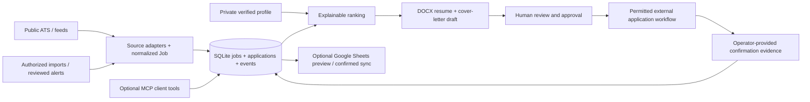

# Architecture and engineering tradeoffs

## Components

The system is local-first: `Store` persists normalized `Job` objects and one application state per job in SQLite. `Agent` orchestrates ingestion, ranking, document preparation and optional Google integrations. The CLI exposes commands without requiring an LLM. `mcp_server.py` offers an optional MCP tool adapter to compatible clients.

## Data ownership and confidence

- A job ID derives from provider, board token, and provider-specific posting ID. Canonical URLs help identify duplicated representations of the same posting.
- Two different requisition IDs **must not** be merged merely because company and title match. URL-based deduplication has limits for reposts and tracking parameters.
- SQLite is the local authoritative application ledger. A Google Sheet is an optional, reviewed mirror; it is not automatically the source of truth.
- Job descriptions, alerts, URLs, source names and recruiter communications are untrusted external data. A saved alert isn't proof that a posting remains open.
- The resume generator draws only from a verified profile and reorders emphasis rather than inventing accomplishments. ATS compliance and hiring outcomes are not guaranteed.

## Application state machine

`discovered → prepared → approved → submitted → assessment/interview/offer/rejected/withdrawn` (some intermediate statuses can be skipped). A submission can be *recorded* only after an approved state and nontrivial confirmation evidence. The backend currently **does not submit applications** and cannot itself verify confirmation authenticity.

The `events` table keeps transition records. State transitions are guarded by the `Store` implementation rather than by a prompt. The exact `APPROVE <job_id>` string is an operator confirmation mechanism, **not** cryptographic human authentication.

## Integration boundaries

- Public ATS discovery uses fixed provider URLs, HTTPS, bounded reads and no redirect-following; RSS requires explicit trusted user configuration. As of v0.4, live remote source behavior remains unverified in this build.
- Local Gmail API permission is read-only; extracted job-alert leads must be reviewed before import. Local Google Sheets permissions allow writes, but `sync-sheet` defaults to preview and applies changes only after exact confirmation.
- A ChatGPT connector does **not** grant Python code access to its OAuth credentials or expose your local CLI to a cloud agent. Direct MCP use requires compatible client access and a securely authenticated transport. Current MCP server code is not production-ready and should not be publicly exposed.
- Any browser-based submission or recruiter email action must be separately implemented and authorized; neither is currently included.

## Why the design is split

This separation lets discovery recover from one provider's failure, allows the fit-score calculation to remain inspectable, and preserves application state independent of LLM context. It also permits the offline synthetic demo to exercise ingestion, ranking and drafting without website accounts, API keys, or personal data.

## Known gaps

Real integration testing, ATS schema drift handling, richer structured eligibility rules, concurrency-safe multi-request Google writes, full credential management, request-level audit redaction, deployment authentication, and form automation remain future work. See [Threat model](THREAT_MODEL.md) and [Roadmap](ROADMAP.md).
