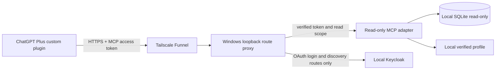

# ChatGPT connection proposal — zero additional service costs

Research checked 2026-10-28; roadmap status reconciled 2026-10-29.
**The Tailscale Personal/Funnel + local Keycloak architecture is selected for
staged qualification. Actual ChatGPT compatibility remains unproven. No external
endpoint or tunnel has been activated.**
No OpenAI billing/credits, paid domain, paid hosting, trial upgrade or metered
infrastructure is authorized. This work created none of those resources.

Reconciliation note, 2026-10-29: the operator selected the Tailscale
Personal/Funnel + local Keycloak architecture. Merged PR #7 qualified local
authenticated HTTP; [PR #8](https://github.com/aryanramz/internship-agent/pull/8)
contains gateway/startup work and is still unmerged. The options below preserve
the research record, not a claim of active connectivity. Actual ChatGPT invocation
remains Issue #3 on an independent track; see the [master roadmap](ROADMAP.md).

The operator has confirmed their Plus account's custom MCP Server URL, Tunnel
and OAuth controls. We accept that account-specific observation. Official
[custom MCP documentation](https://developers.openai.com/api/docs/guides/custom-mcp-server)
describes remote connections and direct tool calls, subject to account/workspace
permissions; this is not a claim that every Plus account has identical access.

## Options

| Option | Current evidence | Decision for this requirement |
|---|---|---|
| OpenAI Secure MCP Tunnel | Private outbound transport, Platform tunnel and runtime API key required. The examined guide does not establish price, billing activation or a no-card/no-credit guarantee. | Zero-cost status **unconfirmed**. A runtime key does not itself prove charges, but Plus is not evidence that the tunnel is free. Do not create a tunnel/key or enable billing. [Official guide](https://developers.openai.com/api/docs/guides/secure-mcp-tunnels) |
| Cloudflare Quick Tunnel | No account/domain; temporary changing hostname; no SSE, no uptime guarantee, 200 in-flight limit. Its email gate requires a browser and does not support non-interactive clients. | Unsuitable for a persistent ChatGPT MCP connection. JSON-only HTTP might permit an experiment with separate OAuth, but is unqualified. [Quick Tunnels](https://developers.cloudflare.com/tunnel/get-started/quick-tunnels/) |
| Named Cloudflare Tunnel | Publishing an application requires an account and a domain on Cloudflare. | Not selected: no domain purchase is allowed. An existing suitable domain could change this assumption; no account/domain is requested. [Prerequisites](https://developers.cloudflare.com/tunnel/get-started/) |
| Tailscale Personal + Funnel | Personal is $0 for non-commercial personal use; Funnel is available on all plans and supplies HTTPS under `ts.net`. Personal requires no billing details. | **Recommended transport candidate**, combined with application OAuth. No paid resources or add-ons. [Pricing](https://tailscale.com/pricing), [billing](https://tailscale.com/docs/account/billing/modify-billing), [Funnel](https://tailscale.com/docs/features/tailscale-funnel) |
| Tailscale Serve alone | Only tailnet members can reach it. ChatGPT cloud is not a member of the user's private network. | Does not satisfy cloud access by itself. [Serve vs Funnel](https://tailscale.com/docs/features/tailscale-funnel) |
| ngrok Free HTTPS | $0 plan with an assigned development domain and finite traffic/request limits. A payment card is explicitly required for free TCP; that path is excluded. HTTPS no-card eligibility was not conclusively established in the examined pages. | Secondary candidate only, not approved for setup. Needs the same application OAuth; free limits and login-page interstitials need validation. [Pricing](https://ngrok.com/pricing), [free limits](https://ngrok.com/docs/pricing-limits/free-plan-limits) |
| zrok Free | Advertises $0/no credit card and a daily traffic limit; public shares without billing verification have an interstitial. | Not selected: unattended MCP compatibility is uncertain, and adding a card to remove the interstitial violates the requirement. [Pricing](https://zrok.io/pricing/) |
| Local stdio MCP host | Already validated locally; no tunnel, domain, hosting or Platform key. | Safe zero-service-cost fallback; it does **not** establish a cloud custom-plugin connection. [Local host support](https://learn.chatgpt.com/docs/extend/mcp) |

## Staged architecture

Use the existing Windows PC, Tailscale's free **Personal** plan, Funnel HTTPS,
and a self-hosted open-source Keycloak authorization server. A small local reverse
proxy would route only the MCP endpoint and required OAuth/discovery paths.
Keycloak is an [open-source identity provider](https://www.keycloak.org/), with
[MCP authorization guidance](https://www.keycloak.org/securing-apps/mcp-authz-server).
Use free local software/storage (for example OpenJDK and PostgreSQL), not hosted
databases, paid identity services or subscriptions. This adds local maintenance,
not a claimed managed-service SLA.

The [authenticated HTTP adapter](MCP_HTTP_VALIDATION.md) is now implemented for
loopback only, preserving the existing three tools. Its configuration explicitly
rejects public resource URLs. The [OAuth comparison](MCP_OAUTH_COMPATIBILITY.md)
records provider experiments and limitations. A future reviewed change must add
an exact external route allowlist and qualify it locally before Funnel activation
or connection in the operator's ChatGPT account.

## Authentication and data boundaries

ChatGPT requires standards-based OAuth authorization code + PKCE S256. Publish
protected-resource and authorization-server metadata; validate signature, issuer,
expiry, one dedicated MCP audience, read-only scopes and the intended local user
before tools execute. Use exact callback allowlisting and a preregistered client
configured in ChatGPT's supported OAuth fields. Static client registration is
distinct from the unsupported client-credentials grant. Browser email gates and
custom API-key headers are not substitutes. [OpenAI authentication requirements](https://developers.openai.com/plugins/build/auth)

Keycloak's [ChatGPT guidance](https://www.keycloak.org/securing-apps/mcp-authz-server#chatgpt-integration)
warns of CIMD incompatibility; OpenAI's current auth guide describes a legacy-field
transition that may resolve that mismatch. The official pages disagree. Do not
rely on automatic CIMD registration initially; use the local static-client
experiments and require audience/resource binding end-to-end. Reject the approach if interoperability
requires an insecure workaround. Do not build a home-grown authorization server.

Funnel makes the selected HTTPS endpoint publicly reachable. Tailnet membership
rules do not authenticate public MCP callers. No tool data or administrative
console may be reachable without application authorization. Expose no Keycloak
admin routes, file server, SQLite download, profile download or Google-token tools.

Database, profile, generated files and Google OAuth credentials remain on the PC.
ChatGPT necessarily receives the requested tool results and separate MCP OAuth
access/refresh tokens; it also exchanges requests and protocol metadata. This is
not an assertion that all data stays on the PC. Google credentials are never used
as MCP authentication. Tool content remains untrusted data, not instructions.

## Costs, accounts and persistence

One free Tailscale Personal account is required; its personal/non-commercial terms
must fit the operator's use. Choose Personal, not a business trial or paid tagged/
ephemeral resource. No payment method or Platform API account is required for this
candidate. Keycloak's local user account and client configuration are separate.
Existing computer/network resources are assumed; no hardware purchase or hosting
resource is part of the proposal. Recheck terms before setup if pricing changes.
Stay within existing ChatGPT Plus usage limits; stop rather than buy credits or
enable an upgrade when a limit is reached.

The PC must remain powered, awake and online. A stable Funnel hostname avoids
recreating callback URLs during routine use; changing the machine/tailnet name
would require connection updates. Funnel has bandwidth limits without a published
numeric quota in its guide and no production availability promise. If limits are
hit, stop/use the local fallback; never upgrade or buy usage automatically.

Funnel background state can resume after reboot. Windows unattended mode and
separate startup arrangements for the MCP/identity/proxy processes would avoid
routine PowerShell commands. Those are future approved setup steps, not actions
already taken. Updates, node-key expiry, OAuth revocation and local backups still
need maintenance. [Funnel persistence](https://tailscale.com/docs/reference/tailscale-cli/funnel),
[Windows unattended mode](https://tailscale.com/docs/how-to/run-unattended)

## Approval and acceptance gate

The operator selected **Personal Funnel + local Keycloak + read-only MCP**.
Pending PR #8 review and local authentication/routing/startup qualification
precede a separately authorized exposure decision. No private credentials are
requested. External-stage acceptance must
prove discovery/calls from the actual ChatGPT account, rejection of missing,
forged, expired and wrong-audience tokens, owner-only scope, restart persistence,
and no possible paid resource/automatic upgrade. Keep only synthetic data during
the first connection test.

If any cost, account or protocol condition fails, report it and retain local
stdio. A compatible local desktop host can launch the server automatically, but
must not be represented as the requested cloud custom plugin. **Issue #3 remains
open until a real authenticated ChatGPT call succeeds.**
