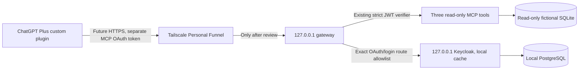

# Phase 3: prepared HTTPS gateway, external connection still gated

The operator approved the Tailscale Personal/Funnel + local Keycloak architecture.
This change implements its loopback gateway and tests public HTTPS identifiers
without enabling Funnel. **Review this PR before any public connection test.**
Issue #3 remains open until an actual authenticated ChatGPT invocation succeeds.
All qualification uses fictional users, profiles and jobs in isolated databases.

## Connection flow and cost boundary



No Platform API key, API credits, paid domain, payment method, hosted database or
paid infrastructure is required or configured. Personal's noncommercial terms
must fit the use; retain that plan and stop rather than enable a trial/upgrade.
Funnel supplies its `ts.net` HTTPS name; it does not authenticate callers. The
PC must remain awake, online and signed in for the current-user backend tasks.
Local files/Google credentials remain on the PC; selected tool results and the
separate MCP OAuth access/refresh credentials necessarily reach ChatGPT.
See the [cost evidence and limits](MCP_CONNECTION_OPTIONS.md).

## Gateway configuration

Copy [the fictional example](../config/mcp-gateway.example.json) to ignored
`config/mcp-gateway.json`, then set its exact reviewed values locally. The example
hostname is illustrative and was never published. Relative paths resolve from
the private configuration file's directory; use an existing fictional ledger.

- `public_origin`: exact lower-case `https://machine.tailnet.ts.net`, no userinfo,
  port, path, query or trailing slash. Only Funnel names are accepted.
- `realm`: one dedicated realm, never `master`; `client_id`: one predefined
  confidential client. `owner_subject`: that fictional user's immutable `sub`.
- `jwks_path`: an operator-pinned **public** JWKS. No private key, token or Google
  grant belongs in the gateway file. Store client/DB secrets only in their local
  provider configuration, with user-only filesystem permissions.
- `keycloak_port` and `listen_port`: distinct unprivileged loopback ports. There
  is no configurable upstream host, arbitrary proxy URL or public listen switch.
- `redirect_uris`: copy the exact redirect from the ChatGPT management page.
  Wildcards, query/fragment additions and other origins are rejected.

The gateway derives resource `PUBLIC_ORIGIN/mcp` and issuer
`PUBLIC_ORIGIN/realms/REALM`. Issuer, signature, single exact audience, expiration,
scope, owner and client checks are retained from [Phase 2](MCP_HTTP_VALIDATION.md),
including revalidation before every tool call. Public tokens additionally refuse
every scope except `openid`, `email`, `profile`, `internship:read`.

```powershell
python -m internship_agent.mcp_gateway --config config/mcp-gateway.json
```

This starts **only a 127.0.0.1 listener**. It does not start Keycloak, install a
service or invoke Tailscale. It fails startup if the local provider's issuer,
endpoint URLs, S256, client authentication, scopes or issuer-identification
metadata disagree. Windows [double-click controls](MCP_WINDOWS_STARTUP.md) avoid
routine shell commands after reviewed one-time setup.

## Provider setup requirements

Use the qualified Keycloak version and a persistent local PostgreSQL database;
development mode, in-memory/H2 storage and a development test password are not an
external deployment. PostgreSQL must listen on loopback only, with a dedicated
database/role and password authentication, not an unrestricted `trust` rule.
Download free local software from its official distribution; do not provision a
managed database or hosted identity subscription.

The private `KC_HOME/conf/keycloak.conf` must include these nonsecret settings,
with ports/hostname matching the gateway configuration:

```properties
db=postgres
db-url-host=127.0.0.1
db-url-database=internship_identity
db-url-port=5432
hostname=https://internship-test.tail-test.ts.net
hostname-strict=true
http-enabled=true
http-host=127.0.0.1
http-port=8180
http-management-host=127.0.0.1
http-management-port=9000
proxy-headers=xforwarded
proxy-trusted-addresses=127.0.0.1
features=resource-indicators
cache=local
metrics-enabled=false
health-enabled=false
http-access-log-enabled=false
log=console
```

Configure the dedicated DB username/password privately. The hidden Windows runner
validates production/local settings and **forces local cache and loopback binding**.
HTTP/management binding alone does not disable Keycloak's cluster networking.
No admin endpoint is routed, and no entire provider port may be sent to Funnel.

In the dedicated realm, disable public registration, password reset, external
identity brokers, implicit/password/service-account grants and offline access.
Keep account setup and administration on the local console. For this initial
fictional proof, use the built-in `keycloak.v2` login theme, no enrollment/required
actions, and client consent disabled; other themes/MFA enrollment/consent flows
require additional route qualification rather than a broad proxy exception.

The predefined confidential client must use authorization code, forced `S256`,
exact redirect URIs and only `basic`, `profile`, `email`, `internship:read` scopes.
Ensure the subject mapper really produces `sub`. Register the MCP URL as a
separate resource client (`resource_url`) and configure one Audience mapper for
that resource. Disable the ordinary account/roles audiences. Use short-lived
access tokens and online refresh rotation. Never enable `offline_access` to fix
a linking error: the [known offline-refresh problem](MCP_OAUTH_COMPATIBILITY.md#why-keycloak-remains-conditional)
remains an exclusion.

## Exact external route policy

| Route | Allowed methods and checks |
|---|---|
| `/mcp` | SDK HTTP methods; every request authenticated; exactly three read-only tools |
| `/.well-known/oauth-protected-resource/mcp` and root alias | GET/HEAD, no query; public resource metadata only |
| `/realms/REALM/.well-known/openid-configuration` and exact issuer-specific RFC 8414/OIDC aliases | GET/HEAD; narrow metadata projection, no registration/CIMD/offline/unsupported grants |
| `/realms/REALM/protocol/openid-connect/auth` | GET; exact client/resource/callback; code, S256, allowed scopes and nonempty state |
| Same prefix `/token` | POST form; Basic client authentication; code or online refresh; exact resource, no URL query |
| Same prefix `/certs` | GET/HEAD; public provider signing metadata |
| Same prefix `/userinfo` | GET with a locally verified owner access token |
| `/realms/REALM/login-actions/authenticate` | GET/POST with bounded session query/form fields |
| `/realms/REALM/login-actions/restart` | GET with bounded session fields |
| `/realms/REALM/login-actions/consent` | POST only; initial consent-disabled flow does not depend on it |
| `/resources/TAG/login/keycloak.v2/...`, `/resources/TAG/common/keycloak/...` | GET/HEAD; fixed theme paths, no traversal/query |

Everything else is denied: admin/master/other realms, account, broker, reset,
registration, required-action enrollment, action tokens, device/password/token
exchange, introspection/revocation/logout, metrics/health/management, admin/account
assets, filesystem paths, SQLite, Google credentials and every write tool.
The OAuth callback lives at **ChatGPT**, not on this PC; the gateway validates
its outgoing redirect rather than opening a local catch-all callback endpoint.

Incoming Host and Origin are exact; duplicate critical headers/fields, malformed
encoding, path escapes, oversized bodies and query tokens are rejected. The
gateway ignores caller-supplied forwarded identity and sends only fixed HTTPS
Host/forwarded values to the fixed loopback provider. It never follows upstream
redirects. Outgoing navigation is restricted to the configured origin/login routes
or exact ChatGPT callback with matching `iss`; token endpoints cannot redirect.
Separate secure cookies are preserved only for the requesting browser. The shared
upstream connection pool never stores cookies or reuses another browser's
session, even if a provider cookie omits `Secure`. Errors are sanitized; access/console logs
are suppressed, including hidden Windows launches. Concurrency, timeouts and
response/body sizes are bounded; this is not a general-purpose internet proxy.

## ChatGPT configuration verified from official documentation

Use **Server URL**, the canonical HTTPS `/mcp` URL, **OAuth only**, and the
predefined client ID/secret. Static credentials take precedence over automatic
registration. This implementation advertises `client_secret_basic`, code/online
refresh and S256, with `internship:read`; `openid email profile` are enabled for
identity. Tool descriptors publish canonical OAuth `securitySchemes` plus the
compatibility `_meta` mirror. Do not select mixed/anonymous authentication.

ChatGPT's stable callback is `https://chatgpt.com/connector_platform_oauth_redirect`
when issuer identification is supported; otherwise it uses
`https://chatgpt.com/connector/oauth/CALLBACK_ID`. Copy the actual displayed value.
Success **and error** redirects must carry the exact issuer. Local experiments
cannot establish what this account's linking screen or refresh client will do.
Sources: [custom-server setup](https://developers.openai.com/api/docs/guides/custom-mcp-server),
[OAuth requirements](https://developers.openai.com/plugins/build/auth),
[tool descriptor fields](https://developers.openai.com/plugins/reference).

## Controlled live-test gate and recovery

Before activation: PR review, full CI/privacy/advisory/security results, synthetic
provider/proxy qualification, exact callback/client/owner/JWKS setup, verified
Windows task controls and local PostgreSQL backup/recovery are prerequisites.
Funnel has not been activated by this change. After separate approval, publish
**only the gateway port**, never the provider/management/database ports or a
folder, and verify the real Host/TLS behavior before connecting ChatGPT. Stop
immediately if authorization, routing or cost assumptions differ.

A missing/expired/forged/wrong-audience token must fail; restart must preserve
issuer, owner, signing keys, data and valid online refresh sessions. If the
provider is unavailable, the gateway fails closed; restore the local provider
and use Start again after scheduler retries are exhausted. Unknown signing keys
require a verified public-key update and restart, not disabled signature checks.
Stop/Disable closes the backend tasks; separately disable any later-approved
Funnel route before maintenance. No automatic upgrade, billing or paid fallback
is permitted. Keep Issue #3 open until the actual authenticated ChatGPT call.
