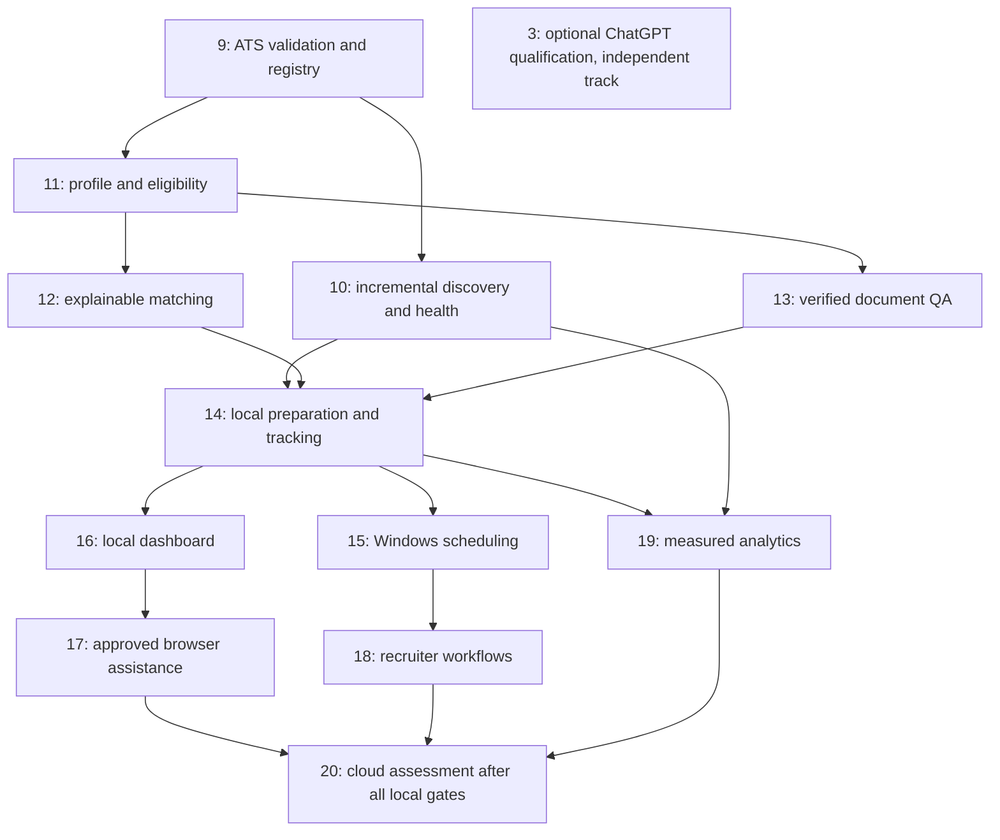

# Master engineering roadmap

Reconciled 2026-10-29 against develop at
`3a79f555617453fc68dd51d36a9d1e51eabd2dcc`, source/tests and GitHub history.
This plan distinguishes merged code from pending review and future work. See the
[component evidence matrix](CAPABILITIES.md), [architecture](ARCHITECTURE.md),
[release gates](RELEASE_PLAN.md) and [next engineering PR](NEXT_ENGINEERING_PR.md).

## Product direction

Internship Agent is an open-source, local-first, ChatGPT-oriented internship
workflow platform. Its target workflow continuously discovers opportunities,
evaluates candidate eligibility and fit, prepares verified materials, assists
with explicitly approved application workflows and tracks recruiting outcomes.
Continuous operation, structured eligibility, a dashboard, browser assistance,
recruiter workflows and analytics are goals, not current promises.

Python remains primary; SQLite is the authoritative application ledger. The CLI
already works independently of ChatGPT. A lightweight local dashboard will offer
another independent interface. MCP and Google integrations are optional.
Deterministic collection, filtering and scoring are the default; optional AI
addresses language/judgment tasks without becoming an authority for facts,
approvals or evidence. No additional paid service is required or authorized.

## Reconciled starting point

- Source readers/imports, board detection/suggestions, deterministic ranking,
  DOCX drafts, application states/events and CLI are implemented.
- [Issue #1](https://github.com/aryanramz/internship-agent/issues/1) is complete:
  merged [PR #4](https://github.com/aryanramz/internship-agent/pull/4) qualified one
  Greenhouse board, not all 18 source types. Expansion is #9.
- [Issue #2](https://github.com/aryanramz/internship-agent/issues/2) is complete:
  merged [PR #5](https://github.com/aryanramz/internship-agent/pull/5) added shared
  per-user credentials and safer Sheets reconciliation. The operator confirmed
  the final Windows credential-reuse preview at `6239e68`; broader live cases
  remain bounded by [the evidence](SHEETS_VALIDATION.md).
- Merged [PR #6](https://github.com/aryanramz/internship-agent/pull/6) and
  [PR #7](https://github.com/aryanramz/internship-agent/pull/7) validate local
  read-only MCP stdio/HTTP. [Issue #3](https://github.com/aryanramz/internship-agent/issues/3)
  stays open until an actual authenticated ChatGPT invocation succeeds.
- The subsequent [PR #8 gateway integration](https://github.com/aryanramz/internship-agent/pull/8)
  includes HTTPS resource identity, exact OAuth routing, synthetic provider/proxy
  qualification and prepared Windows identity controls. These are code/local
  proofs, not activated connectivity. See [gateway qualification](MCP_GATEWAY_VALIDATION.md).
  Funnel, actual ChatGPT invocation and native task qualification remain gated.

## Development priorities

1. Reconcile documentation/backlog against evidence (this change).
2. Expand real discovery: three ATS providers and employer registry, then source
   health and posting lifecycle.
3. Model verified candidate facts and structured internship eligibility.
4. Improve explainable ranking, preferences and verified documents.
5. Qualify one recoverable local preparation/tracking workflow.
6. Add Windows unattended scheduling and a lightweight local dashboard.
7. Qualify ChatGPT connectivity independently; it must not block local progress.
8. Add narrowly permitted, approval-based browser application assistance.
9. Add verified recruiter workflows and measured analytics.
10. Assess optional cloud operation only after local release gates pass.

## Workstreams and actionable issues

Every issue defines objective, existing modules, expected implementation,
acceptance, tests, dependencies and exclusions. Dependency links in issue bodies
are scheduling constraints; labels group workstreams. Milestones use acceptance
gates rather than invented deadlines or completion percentages.

| Workstream | Remaining engineering scope | Issue / gate |
|---|---|---|
| A — Discovery | Greenhouse/Lever/Ashby qualification; compatible employer/ATS registry | [#9](https://github.com/aryanramz/internship-agent/issues/9), R1 |
| A — Discovery | Incremental scans/checkpoints, health/backoff, freshness, closure/reopening, provenance/dedup; permitted board suggestions/imports | [#10](https://github.com/aryanramz/internship-agent/issues/10), R1 |
| B — Profile/eligibility | Verified facts; graduation/enrollment/season/work authorization/location; eligible/uncertain/ineligible with evidence | [#11](https://github.com/aryanramz/internship-agent/issues/11), R2 |
| C — Matching | Internship taxonomy, skills/experience, configurable weights/preferences, explanations and optional calibration | [#12](https://github.com/aryanramz/internship-agent/issues/12), R2 |
| D — Documents | Master profile, career-track/job variants, letters/answer drafts, claim trace and QA | [#13](https://github.com/aryanramz/internship-agent/issues/13), R2 |
| E — Workflow | Recoverable preparation/review/tracking, document-bound approval and duplicate-action/evidence handling | [#14](https://github.com/aryanramz/internship-agent/issues/14), R3 |
| G — Scheduling | Windows controls, retries, catch-up, overlap protection and private notifications | [#15](https://github.com/aryanramz/internship-agent/issues/15), R4 |
| G — Interface | Lightweight local dashboard and CLI parity, with local request/action security | [#16](https://github.com/aryanramz/internship-agent/issues/16), R4 |
| G — ChatGPT | Reviewed transport, native startup recovery and actual account invocation | Existing [#3](https://github.com/aryanramz/internship-agent/issues/3), parallel I1 |
| E — Browser assistance | One permitted workflow, concrete approval, MFA/CAPTCHA handoff, evidence and uncertain-result recovery | [#17](https://github.com/aryanramz/internship-agent/issues/17), R5 |
| F — Outreach | Verified contacts, personalized drafts, optional Gmail reply tracking and follow-up suggestions | [#18](https://github.com/aryanramz/internship-agent/issues/18), R6 |
| H — Analytics | Source/discovery performance, application/interview cohorts and opt-in scoring feedback | [#19](https://github.com/aryanramz/internship-agent/issues/19), R6 |
| Optional operation | Cloud feasibility/security/cost decision only, after reliable local releases | [#20](https://github.com/aryanramz/internship-agent/issues/20), R7 |

Broad platform coverage uses permitted employer APIs, alerts, feeds, connectors
and reviewed CSV/JSON imports. A platform name is not evidence of an integration.
No protected-account scraper or indiscriminate crawler substitutes for permission;
see [source coverage](SOURCE_MATRIX.md).

## Dependencies and release slices

| Gate | Proposed version after acceptance | Measurable exit |
|---|---|---|
| R1 | 0.5.0 | Three-provider evidence, compatible registry, recoverable scans/health and conservative availability; #9 + #10 |
| R2 | 0.6.0 | Explicit eligibility, preference-aware ranking and verified document QA; #11–#13 |
| R3 | 0.7.0 | Fictional CLI preparation/tracking passes restart/retry/approval/evidence checks without MCP/Google; #14 |
| R4 | 0.8.0 | Qualified Windows scheduling and accessible local dashboard; #15 + #16 |
| R5 | 0.9.0 | One permitted browser flow qualifies approval, handoff, evidence and duplicate protections; #17 |
| R6 | 0.10.0 | Verified-contact draft/reply flows and reconciled analytics with explicit denominators; #18 + #19 |
| R7 | No version promised | Cloud go/no-go after R1–R6; #20 creates no infrastructure |
| I1 | Next suitable accepted release | Actual authenticated ChatGPT call plus refresh/recovery/security evidence; #3, independent of R1–R4 |

These replace the old mixed v0.5/v0.6 phase labels. They do not retroactively
publish releases or bump runtime metadata. Detailed acceptance, version drift
and publication procedure are in [RELEASE_PLAN.md](RELEASE_PLAN.md).

## Measurement and review

Collect source success/failure/empty-scan counts, duplicate provenance, missing
descriptions, manually reviewed ranking labels, document QA findings and recorded
application/interview outcomes. Define grain, denominator, evidence and time
window before presenting metrics. Never infer hiring probability or report
uncollected conversion/accuracy/completion percentages.

Engineering PRs branch from latest develop, name issue/dependencies, preserve
migrations/history/privacy and state exactly what ran. Use fictional fixtures;
live checks are opt-in, authorized and bounded. Private integrations and
consequential actions need their own authorization. Keep main unchanged and
leave PRs unmerged until reviewed.
